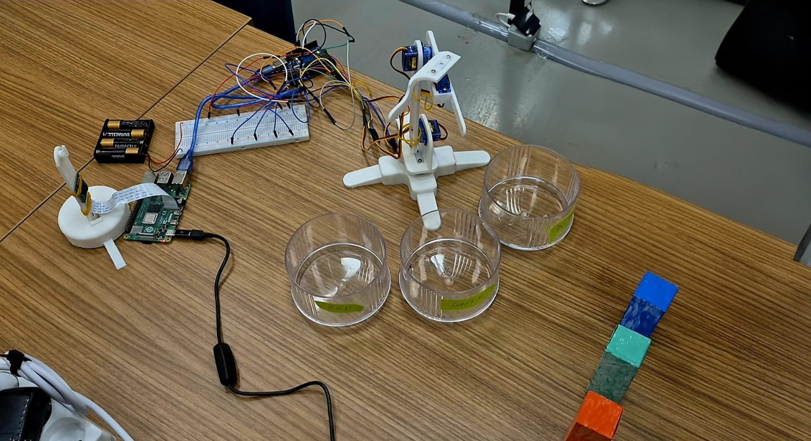

# Automated Color Sorting Arm

**Embedded Systems · UM6P College of Computing**

Assia SNISSI · Khadija LEKBIRI · Manal ZAIDI · Rhita RHALLAMI

[Technical report](main.pdf) · [LaTeX source](main.tex)

## Project overview

The prototype identifies a red, green, or blue object at a fixed pickup station and transfers it to the corresponding cup after operator approval. It combines camera-based perception, route validation, and timed pick-and-place on a 3D-printed arm.

## System architecture

| Stage | Responsibility |
| --- | --- |
| **Perceive** | The Raspberry Pi camera captures one frame. OpenCV classifies the pickup region by HSV mask coverage. |
| **Decide** | The Pi selects a color route, requests a kinematic check from the Uno, and asks the operator to approve it. |
| **Act** | The Arduino Uno computes joint targets and sequences the three positioning servos and gripper. |

The controllers exchange newline-delimited commands and replies over USB serial at **115200 baud**. The Arduino advances the route on its own timers while the Pi monitors replies. [Architecture and model](docs/MODEL_AND_ARCHITECTURE.md)

## Hardware components



The printed arm uses four SG90 servos. The Arduino drives the base, shoulder, elbow and gripper on D6, D9, D10 and D11, respectively. An external battery supply powers the servos and shares signal ground with the Uno. The Pi camera faces the pickup station and three cups serve the red, green, and blue destinations. The [report](main.pdf) identifies the components on the photo. The [demo frame](figures/sorting_demo.jpg) shows the arm gripping a blue object.

## Computer-vision pipeline

Picamera2 captures one 640 × 480 frame. OpenCV converts the 200 × 200-pixel ROI at columns `220:420` and rows `140:340` to HSV and counts matches for each color. Red uses two hue intervals to account for hue wraparound. The Pi selects the color with the greatest coverage if at least 20% of the ROI matches. Otherwise it returns `UNKNOWN` without sending a route. Red selects DR, green selects DG, and blue selects DB. The pickup point is fixed by the firmware.

## Kinematic modeling and numerical validation

The model uses base, shoulder, and elbow angles `(b, s, e)` and two nominal 12 cm links. Forward kinematics projects the links into the arm plane and rotates the horizontal reach about the base. Inverse kinematics solves the link triangle for each Cartesian target. For example, the above-pickup target `(3.93, 14.68, 14.18) cm` yields approximately `(15°, 73°, 120°)`.

**9/9 programmed poses** passed MATLAB's FK–IK check. For each target, the self-test verifies the IK angles are in range and the FK reconstruction error is below `0.0001 cm`. This tolerance measures numerical agreement within the nominal model. [Equations and conventions](docs/MODEL_AND_ARCHITECTURE.md#geometric-model)

## Arduino and Raspberry Pi control logic

- **Raspberry Pi** follows **Capture → Classify → Check Route → Confirm → ARM/RUN → Monitor**. `CHECK COLOR` tests route feasibility before actuation. The Pi monitors for completion, an Arduino error, or its 180-second deadline.
- **Arduino** accepts `RUN COLOR` only while armed and with a valid route and available controller. The red route is **AP → PICK → AP → HOME → AR → DR → AR → HOME**. It closes the gripper at PICK, opens at DR, and waits one second between automatic waypoints after movement and any gripper action. Green and blue use their corresponding approach and release points.
- **Coordination** relies on the firmware invariant that an active route implies an armed controller. `STOP` cancels motion updates and attached servos hold their last commands. The completion line records the end of the commanded sequence. [State diagrams and serial behavior](docs/FINITE_STATE_MACHINES.md)

## MATLAB, Simulink, and PyBullet

| Tool | Contribution |
| --- | --- |
| **MATLAB** | Solves and checks kinematics, generates joint-command CSVs, and verifies waypoint, timing, gripper, and capacity-state transitions. |
| **Simulink** | Displays the four red-route command angles with a zero-order hold between samples. |
| **PyBullet** | Replays the CSVs through a generic 3D arm and compares its tool frame with the nominal trajectory. Object attachment and release are scripted for visualization. |

The modeled red, green, and blue runs take **45.7 s**, **43.1 s**, and **49.5 s**, respectively, from route start to final HOME. The modeled pickup descent sweeps **2.73 cm** laterally despite its vertically aligned endpoints. The sweep informs clearance checks during physical setup.

## Running the physical prototype

1. Upload the [SEVEN sketch](Original_Source_Code/Arduino/SEVEN_color_sorter_original/SEVEN_color_sorter_original.ino) to the Arduino Uno using Arduino IDE and the Servo library. Wire the servos to the external supply with common ground. Verify the startup posture, gripper calibration, and unobstructed sweeps before sending `ARM`.
2. In the Arduino serial monitor use **115200 baud** and newline termination. Use `POSES` to inspect targets and send `CHECK RED`, `CHECK GREEN`, and `CHECK BLUE` to check the configured routes. Close the monitor before starting the Pi controller.
3. On Raspberry Pi OS, use an environment with working Picamera2, OpenCV, NumPy, and pyserial. Connect the Uno by USB. The baseline script opens `/dev/ttyACM0`. The capacity controller accepts a `--port` override.
4. Place one object at pickup in the camera ROI. From the repository root, start the baseline controller as shown below, review the chosen route, and enter `yes` to approve it. Use the capacity controller for all counted runs.

```bash
mkdir -p runtime
cd runtime
python3 ../Original_Source_Code/RaspberryPi/color_sorter_original.py
```

The baseline script saves its annotated frame and ROI in the working directory. The operator supervises physical movement and observes each deposit.

## Reproducing software verification

From the repository root, with Python 3.10 or later:

```bash
python tools/preflight.py
python -m unittest discover -s tests -v
python PyBullet/simulate.py --verify-only --all
python PyBullet/test_urdf.py
```

These checks use the standard library and the included CSVs. They verify source hashes and route agreement, exercise capacity and recovery with mocked serial I/O, and check the URDF kinematic transforms. On Windows, `powershell -ExecutionPolicy Bypass -File .\RUN_CHECKS.ps1` runs all four checks.

Open MATLAB in the repository's `MATLAB/` directory and run:

```matlab
seven_self_test
seven_fsm_self_test
seven_slot_fsm_self_test
run_SEVEN_project
seven_fsm
seven_slot_fsm
```

The first three commands run the self-tests. The remaining commands generate trajectories, plots, and state traces under `MATLAB/outputs/`. With Simulink installed, run `model = seven_build_simulink(); sim(model); open_system(model)` to inspect the red-route command replay.

[Bundled trajectories](PyBullet/trajectories/) support verification and replay on a fresh checkout. PyBullet uses local MATLAB exports when present, and preflight checks their numerical agreement with the bundled commands.

Install the listed dependencies for 3D replay:

```bash
python -m pip install -r PyBullet/requirements.txt
python PyBullet/simulate.py --all --headless
python PyBullet/simulate.py --color BLUE
```

To rebuild the report, run `pdflatex -halt-on-error main.tex` twice from the repository root with a LaTeX distribution that includes TikZ, Latin Modern, and the packages declared in [main.tex](main.tex).

| Location | Contents |
| --- | --- |
| [Original_Source_Code/](Original_Source_Code/) | Arduino sketch and both Raspberry Pi entry points |
| [MATLAB/](MATLAB/) · [PyBullet/](PyBullet/) | Numerical models, self-tests, URDF, and route CSVs |
| [docs/](docs/) · [figures/](figures/) | Technical notes, state diagrams, physical photos, and model figures |
| [config/](config/) · [tests/](tests/) · [tools/](tools/) | Capacity configuration, unit tests, and preflight |

## Additional feature · Bin-capacity management

The capacity-aware Pi entry point independently tracks **three objects per bin** at the original DR, DG, and DB drop coordinates. It rejects a fourth counted placement before serial access and commits the count only after the matching route starts and completes. A persisted pending record and an operating-system lock support recovery and prevent concurrent counted runs. Use the same state file for every counted run. [Recovery and reset instructions](docs/SLOT_TRACKING_AND_FSM.md)

```bash
python Original_Source_Code/RaspberryPi/sort_with_slots.py --status
python Original_Source_Code/RaspberryPi/sort_with_slots.py --verify-config
python Original_Source_Code/RaspberryPi/sort_with_slots.py --color RED --dry-run
python Original_Source_Code/RaspberryPi/sort_with_slots.py
```

The first three commands can run without hardware. Use `python3` for the physical run on Raspberry Pi OS. Counts estimate occupancy from completed commands and operator reconciliation.

## Applications and future work

A recycling station could retain the route-selection and manipulation architecture while using near-infrared or hyperspectral sensing to identify streams such as PET, HDPE, and PP. The current RGB camera sorts by visible color. Further development could add a six-axis manipulator for wrist orientation, AI-powered adaptive grasping for varied objects, and multi-robot scheduling for shared industrial workspaces.

## References and credits

- T. Selçuk Yüksel designed the open-source **SEVEN 3-DOF Arduino Robotic Arm** under the MIT license. The sorting firmware, vision pipeline, and evaluation models are project contributions. [Upstream SEVEN design](https://github.com/elevenMiles/Robotic_Arm_Seven)
- The prototype uses Arduino Servo, Raspberry Pi Picamera2, and OpenCV HSV thresholding. [Arduino Servo](https://docs.arduino.cc/libraries/servo/) · [Picamera2](https://github.com/raspberrypi/picamera2) · [OpenCV](https://docs.opencv.org/4.x/da/d97/tutorial_threshold_inRange.html)
- The offline models use MATLAB and PyBullet. [MATLAB](https://www.mathworks.com/help/matlab/) · [PyBullet](https://github.com/bulletphysics/bullet3/tree/master/docs/pybullet_quickstart_guide)
