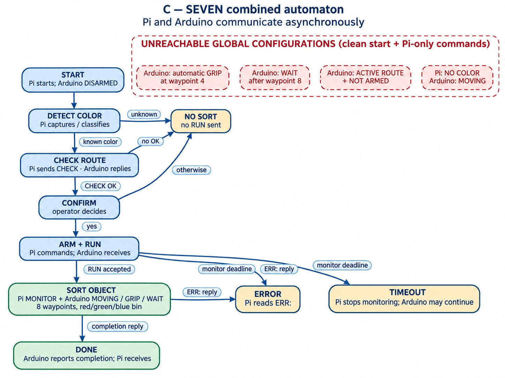

# Finite-state machines and serial coordination

## Raspberry Pi · perception and dispatch

| State | Transition |
| --- | --- |
| CAPTURE → CLASSIFY | Acquire one frame and classify the fixed ROI. If the highest HSV mask coverage is below 20%, end at NO_COLOR. |
| CHECK_ROUTE | Send `CHECK COLOR` and look for `Route model check OK`. If it is absent, end at REJECTED before arming. |
| CONFIRM | Prompt the operator. A declined route ends at DECLINED. |
| ARM → RUN | Send `ARM`, wait approximately one second, then send `RUN COLOR`. |
| MONITOR | Finish at DONE on `Color route complete`, ERROR on `ERR:`, or TIMEOUT after 180 seconds. |

The baseline script uses a timed wait after `ARM`. The [capacity-aware controller](SLOT_TRACKING_AND_FSM.md) waits for an arming acknowledgement and matches the completion message to the run before committing a count.

## Arduino · guarded, timed actuation

| Command or event | Effect |
| --- | --- |
| `ARM` | Attach actuators from DISARMED and apply the initial angles `[105, 73, 60]` and open gripper command `90°`. An already-armed request leaves the posture unchanged. |
| `CHECK COLOR` | Evaluate the color's route waypoints against the kinematic and command guards without starting a sequence. |
| `RUN COLOR` | Require an armed, idle controller, a valid route, and an idle gripper with distinct open and closed targets. Open the gripper first if needed, then start the automatic route. |
| Waypoint completion | Close at PICK (step 2), open at the drop point (step 6), and wait for gripper interpolation after each action. Enter WAITING after any nonfinal waypoint. |
| WAITING | Advance after at least 1000 ms in automatic mode, or on `NEXT` in `MANUAL COLOR` mode. |
| Final HOME | Emit the completion line and return to ARMED_IDLE. |
| `STOP` | Cancel active interpolation, gripper updates, and waypoint progression. The attached servos hold their last commanded outputs. |

The red route is `AP → PICK → AP → HOME → AR → DR → AR → HOME`. Green and blue substitute AG/DG and AB/DB.

## Combined automata

The two state machines exchange messages asynchronously. For example, the Pi can enter MONITOR before the Arduino receives `RUN`. A modeled joint or gripper transition can occur while the Pi remains in MONITOR. A host timeout ends the Pi's monitoring while the Arduino may continue. DONE means command interpolation finished. The operator observes the physical pickup and deposit.

The controller invariant is **G(sequenceActive ⇒ armed)**, where **G** means the implication holds in every reachable state. At reset the two flags are false. The guarded route-start command can set `sequenceActive` only after verifying `armed`. Waypoint progress preserves `armed`, and completion or `STOP` clears the active sequence. The diagram assumes a clean start and commands from the Pi workflow.

## Reproducing the control models

Run `seven_fsm` and `seven_fsm_self_test` from the `MATLAB/` folder. The generator exports the Pi and Arduino transition tables, state graphs, and timed traces under `MATLAB/outputs/fsm/`. For each route, the self-test checks eight waypoint starts, two gripper actions, seven waits, final ARMED_IDLE, and agreement between the completion time and simulated command duration. The state graphs run as offline MATLAB models.
