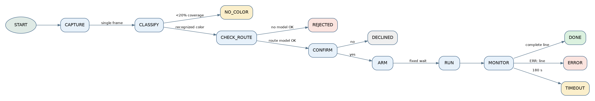
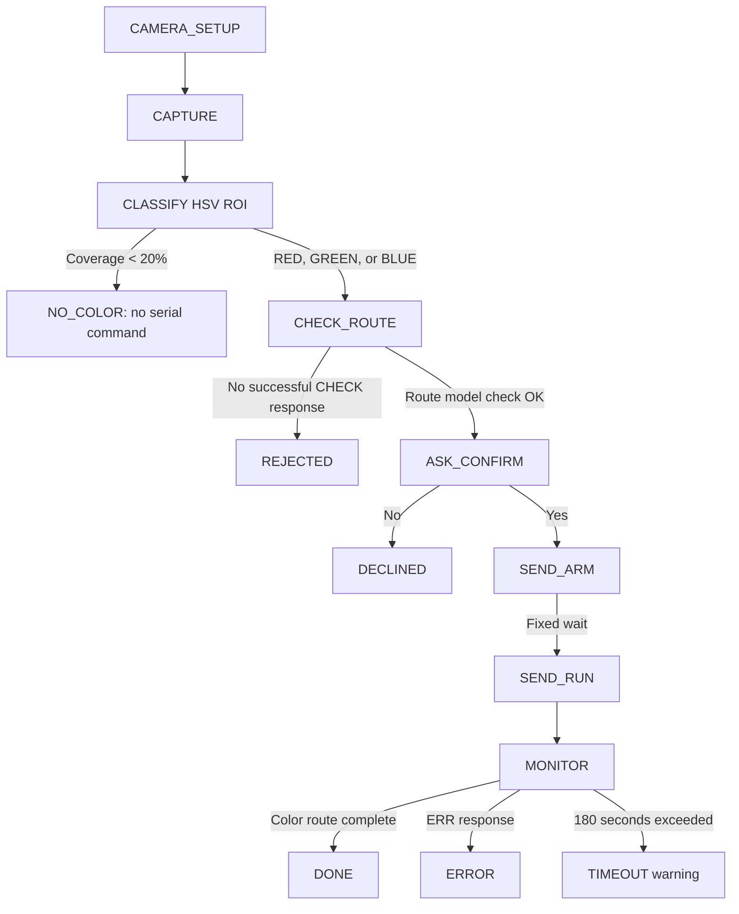
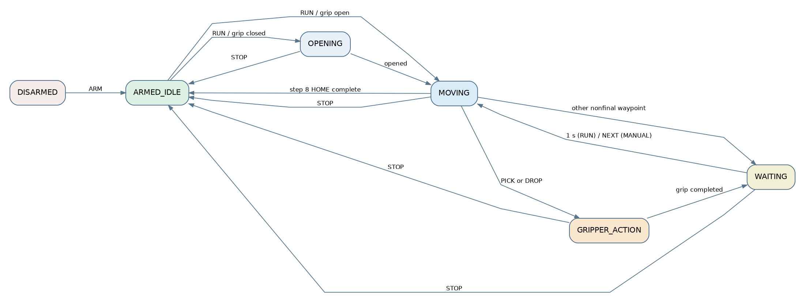
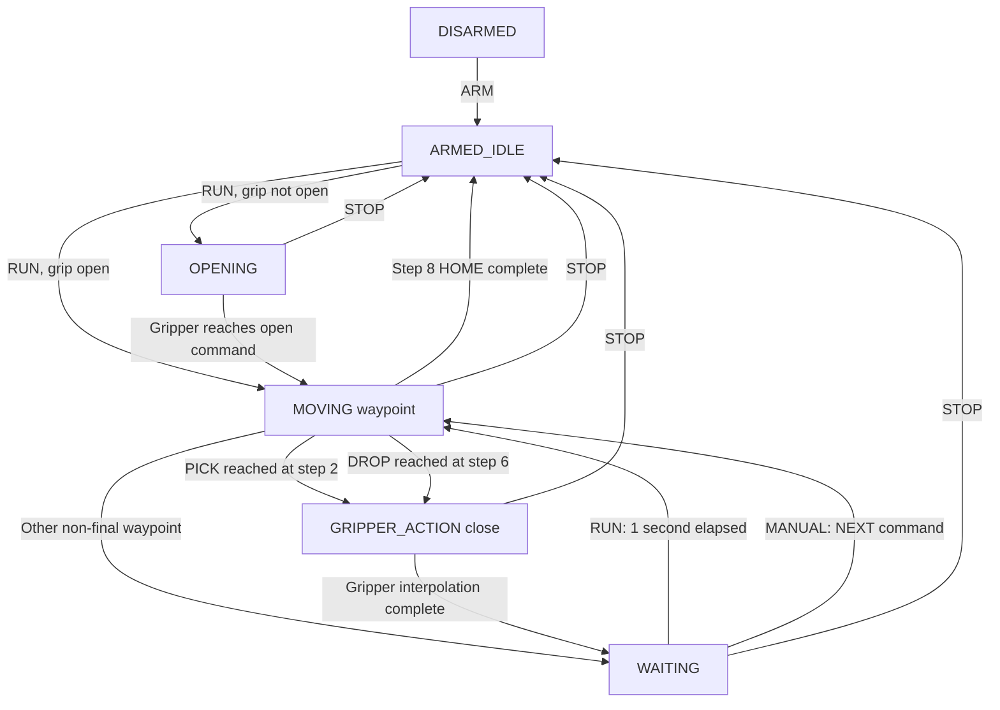

# Finite-state-machine specifications

This document formalizes the **existing** Raspberry Pi and Arduino behavior. The source controller is procedural Python/C++, not Stateflow. A MATLAB function (`MATLAB/seven_fsm.m`) generates transition tables, state graphs, and timed route traces **without requiring Stateflow**. The diagrams are documentation models; MATLAB is not controlling the real robot.

## 1. Raspberry Pi: one-shot perception and command FSM





Notes: the Pi checks **model reachability** by looking for the exact Arduino text `Route model check OK`, not physical collision safety. After sending `ARM`, the script waits approximately one second then sends `RUN` without checking for a specific positive ARM acknowledgement. The route-complete line indicates completed **command interpolation**, not verified movement. A Python-side timeout does not send a physical emergency stop.

## 2. Arduino: arm and sorting-route FSM





The `ARM` command sets initial model angles `[105,73,60]` and gripper OPEN = `90°`. The automatic route is eight waypoints and seven pauses, with a gripper close at step 2 (default `115°`) and open at step 6 (`90°`). `STOP` cancels updating motor commands but the servos **hold their last outputs**. Invalid `RUN` while moving or unreachable poses are rejected by the firmware; those rejection guards are described in the generated transition CSV and original source rather than redrawn at every arrow.

## 3. MATLAB implementation

From the MATLAB project folder:

```matlab
seven_fsm
seven_fsm_self_test
```

This creates `MATLAB/outputs/fsm/` containing:

| File | Interpretation |
|---|---|
| `raspberry_pi_transitions.csv` | Pi states, trigger/guard, target state, effect |
| `arduino_transitions.csv` | Arduino states, event/guard, target state, effect |
| `raspberry_pi_fsm.png`, `arduino_fsm.png` | Auto-laid-out state diagrams, with exact guard text in CSV |
| `trace_RED.csv`, `trace_GREEN.csv`, `trace_BLUE.csv` | Time-stamped arm route-state events from the commanded MATLAB simulation |
| `timeline_RED.png`, `timeline_GREEN.png`, `timeline_BLUE.png` | State-versus-time graphs |

`seven_fsm_self_test` verifies for each color exactly **8 waypoint starts, 2 gripper actions, 7 waits, a final ARMED_IDLE state**, and a route completion timestamp matching the modeled command sequence. This is a consistency check against *the software model*, not a test of the physical arm.

## 4. Interfaces and missing feedback

The Pi FSM and Arduino FSM communicate using ASCII serial commands. Vision operates **once** per Python invocation, whereas Arduino `loop()` updates active movement non-blockingly. The only completion signal sent to Pi is a string printed by firmware. There are no limit switches, gripper contact sensors, joint encoders, or direct pose measurements, so there is no feedback-driven correction transition in the model.

If a future course extension requires a **Stateflow** chart, these CSV transition tables and Mermaid diagrams are the precise starting specification. An automatically generated real-time Stateflow controller is **not** included or claimed.
