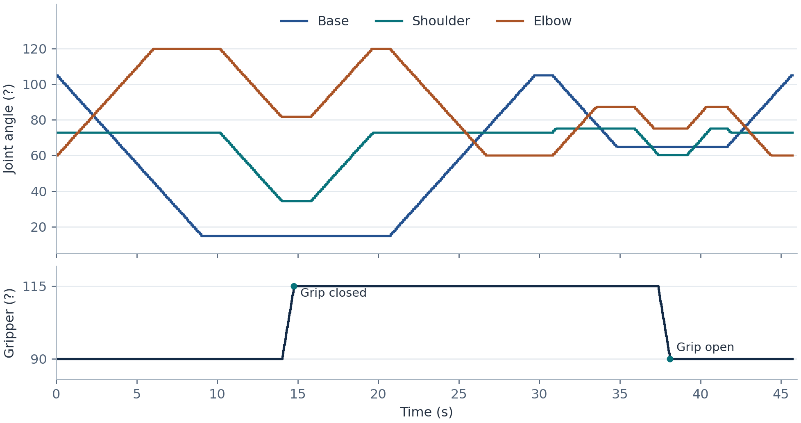

# System architecture and kinematic model

## Controller boundary

The Raspberry Pi captures one 640 × 480 frame and classifies its fixed 200 × 200 pickup ROI using HSV masks. It sends the winning color to the Arduino over USB serial at 115200 baud after a successful route check and operator approval. The Uno owns the waypoint coordinates, inverse kinematics, and timed joint and gripper commands. D6 drives the base, D9 the shoulder, D10 the elbow, and D11 the gripper. [Serial protocol and state machines](FINITE_STATE_MACHINES.md)

## Geometric model

The origin is at the shoulder pivot. Base angle $b$ is measured from the positive $y$ axis toward positive $x$. Shoulder angle $s$ is measured above the horizontal in the arm plane. The interior elbow angle $e$ equals $\pi$ when the links are straight. The nominal shoulder-to-elbow and elbow-to-tool lengths are $L_1=L_2=12\,\mathrm{cm}$. Trigonometric expressions use radians and the command interface uses degrees.

$$
\begin{aligned}
r &= L_1\cos(s)+L_2\cos(s+e-\pi),\\
x &= r\sin(b),\qquad y=r\cos(b),\\
z &= L_1\sin(s)+L_2\sin(s+e-\pi).
\end{aligned}
$$

For a Cartesian target, form the triangle with sides $L_1$, $L_2$, and $d$ in the arm plane. The implemented branch uses the law of cosines and adds the shoulder triangle angle to the target elevation.

$$
\begin{aligned}
r &= \sqrt{x^2+y^2},\qquad d=\sqrt{r^2+z^2},\qquad b=\operatorname{atan2}(x,y),\\
s &= \operatorname{atan2}(z,r)+\arccos\!\left(\frac{L_1^2+d^2-L_2^2}{2L_1d}\right),\\
e &= \arccos\!\left(\frac{L_1^2+L_2^2-d^2}{2L_1L_2}\right).
\end{aligned}
$$

For AP, the target $(3.93,14.68,14.18)\,\mathrm{cm}$ gives approximately $(15^\circ,73^\circ,120^\circ)$. MATLAB solves IK and reconstructs the target with FK for each of the nine firmware poses. All nine pass the checks for angle bounds and Euclidean residual below $10^{-4}\,\mathrm{cm}$.

The firmware enforces finite coordinates, $x\ge 1\,\mathrm{cm}$, $z\ge-6\,\mathrm{cm}$, $3\le d\le23\,\mathrm{cm}$, joint commands in $[0^\circ,180^\circ]$, and FK reconstruction error below $0.1\,\mathrm{cm}$. The angle bounds are command limits. The physical joint range and clearance must be verified on the assembled mechanism.

## Waypoints and trajectory generation

| Step | Target | Gripper action |
| ---: | --- | --- |
| 1 | AP, above pickup | |
| 2 | PICK | Close |
| 3 | AP, after lifting | |
| 4 | HOME | |
| 5 | AR, AG, or AB, above the selected cup | |
| 6 | DR, DG, or DB, at the selected cup | Open |
| 7 | AR, AG, or AB, after retracting | |
| 8 | HOME | |

The reference MATLAB routes start after ARM at $[105^\circ,73^\circ,60^\circ]$ with the gripper open. The model advances each positioning joint by up to 1° per 100 ms and the gripper by 1° per 30 ms. It pauses for 1 s between automatic waypoints once any associated gripper action is complete. The modeled duration excludes capture, serial exchange, and approval time.

The modeled pickup descent travels up to 2.73 cm laterally from the vertical line through the pickup point because the controller interpolates the joint angles. The following plot shows this path in the shoulder-relative horizontal plane. [MATLAB Cartesian XY footprint](../figures/xy_footprint.pdf)

## PyBullet replay

PyBullet uses metres and radians, and its URDF places the shoulder 0.06 m above the simulated floor. The replay maps $q_{\mathrm{yaw}}=-b$, $q_{\mathrm{shoulder}}=s$, and $q_{\mathrm{elbow}}=e-\pi$. It compares the URDF tool frame with the CSV reference after compensating for the shoulder height. Virtual prismatic jaws and scripted attachment visualize pickup and release. [Blue route replay](../figures/SEVEN_PyBullet_BLUE.png)

The trajectory comparison establishes agreement among command and geometric models. Physical positioning and grasp behavior depend on the assembled robot and its operating conditions.
