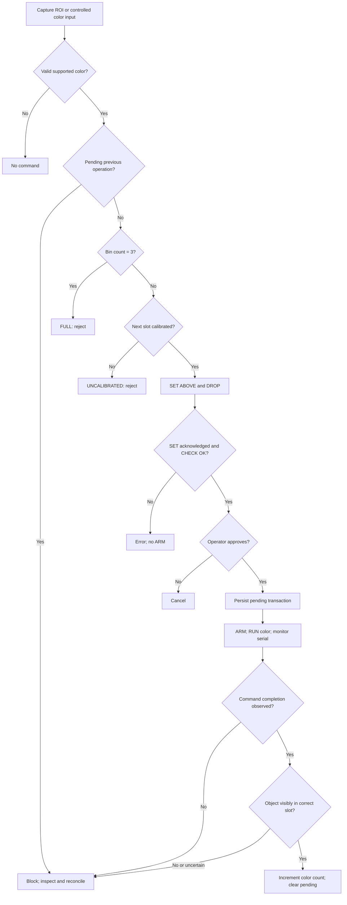

# Three-spot capacity controller: specification and state machines

## Scope and provenance

This document describes the **new optional Raspberry Pi controller** `Original_Source_Code/RaspberryPi/sort_with_slots.py`. It supplements, and does not replace, the original single-drop workflow. The original Arduino commands remain intact. The extension has been tested with a software-only fake Arduino serial interface, **not yet on the complete physical nine-slot layout**.

## State and invariants

The state file `runtime/occupancy.json` holds `counts.RED`, `counts.GREEN`, `counts.BLUE` and `pending`:

- Each count is an integer between **0 and 3** and represents **operator-confirmed** occupancy, not actual sensor readings.
- `count = 0` selects slot 1, `count = 1` selects slot 2, and `count = 2` selects slot 3. `count = 3` means **FULL**.
- A slot with `null` calibration is **UNCALIBRATED** and not executable.
- The next slot has two measured Cartesian positions in centimetres: `above` and `drop`.
- A `pending` placement is persisted **before** `ARM` and `RUN`. It blocks any new sort until operator reconciliation.
- The counter increments only on operator confirmation after command completion or explicit recovery with `--resolve-pending placed --confirm`.
- A timeout/error leaves the transaction pending, and no count is incremented automatically.
- Serial route completion is not physical confirmation of pickup/release.

### Capacity-aware Raspberry Pi flow

The Arduino itself still performs the original eight programmed motions and has no occupancy-aware sensor. It receives dynamically updated destinations with `SET AR/DR`, `SET AG/DG` or `SET AB/DB`, then executes `CHECK COLOR` and `RUN COLOR`.

## Serial protocol, in order

1. Open serial at 115200; Arduino may reset on connection; wait for startup.
2. `SET [above pose] x y z`; require `SAVED [pose]` acknowledgement.
3. `SET [drop pose] x y z`; require the corresponding `SAVED` acknowledgement.
4. `CHECK COLOR`; require `Route model check OK` (reachability only).
5. Ask operator to inspect the physical workspace and approve.
6. Atomically save pending `{color,slot,started_utc}`.
7. Send `ARM`, require `ARMED:` response. This can move the physical servos!
8. Send `RUN COLOR`, monitor for a route-start indication, errors, then command-completion line.
9. Ask operator to verify actual placement. Only a confirmed placement advances the count.

No `STOP` command in this firmware removes power. On a timeout or exception, mechanically safeguard the robot, inspect the bin, and resolve the pending transaction before resuming.

## MATLAB finite-state machine

The submission contains `MATLAB/seven_slot_fsm.m`, which creates a CSV transition table and a `digraph` state diagram under `MATLAB/outputs/fsm/`. `seven_slot_fsm_self_test.m` checks the FULL/UNCALIBRATED/PENDING transitions and the logical three-per-color capacity invariant.

The MATLAB FSM is a **formalized controller description**, not a deployed Stateflow controller, motion-dynamics model, or simulation of physical bin occupancy. The existing `MATLAB/seven_fsm.m` still documents the legacy single-slot camera and Arduino route FSMs.

## Required commissioning before nine-slot physical demonstrations

- Measure six additional slot coordinates and six associated safe approach points, relative to the shoulder pivot.
- Replace each `null` in `config/slots.json` with numeric `above` and `drop` coordinates.
- Check every pose with `--verify-config`, Arduino `CHECK`, and physical manual clearance verification; numerical reachability alone is insufficient.
- Test whether the end effector can descend and withdraw without contacting adjacent stored objects, bin walls, wiring, or base.
- Run multiple actual trials for every color and occupied-position index; document mistaken color detection, failed grasps, wrong-bin placements and physical timing.
- Ensure only one Raspberry Pi sorting-controller instance is active; persistence uses atomic writes but is not a concurrent database transaction system.
- Physically empty a bin before resetting its software counter.

## Test evidence and interpretation

`python -m unittest discover -s tests -v` runs synthetic-coordinate and fake-serial tests. Synthetic coordinates are deliberately kept **inside the test module** and are not exported to `config/slots.json`. Passing the test suite proves that the counting, state persistence and command sequencing logic behave as specified under tested conditions; it does **not** demonstrate a measured nine-slot system.
