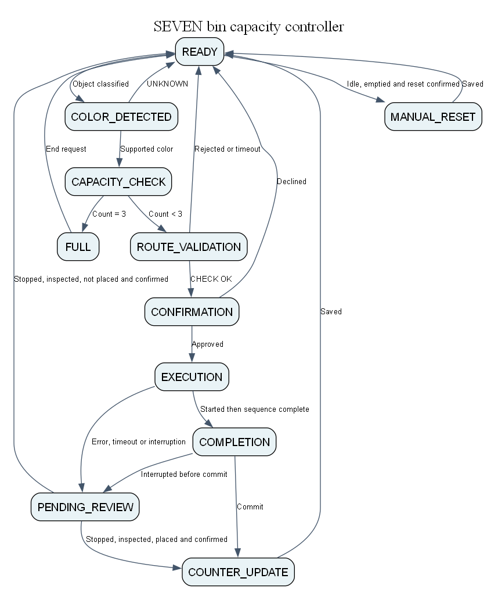

# Bin capacity tracking and finite-state machine

Each color has one bin, one calibrated firmware destination and a capacity of three objects. RED always uses DR, GREEN uses DG and BLUE uses DB. The Pi reads the count to decide whether to allow the route. The firmware supplies the coordinates and runs the same eight waypoints for every accepted object of a given color.

## Normal sequence

| State | Controller action |
|---|---|
| COLOR_DETECTED | Classify a single camera frame or accept the supplied test color. UNKNOWN ends the request before serial access. |
| CAPACITY_CHECK | Read the selected bin count. A count of three returns FULL. A pending operation blocks further sorting. |
| ROUTE_VALIDATION | Send `CHECK COLOR`. A rejection or timeout ends the request before motion. CHECK tests modeled reachability. |
| CONFIRMATION | Ask the operator to inspect the workspace and approve. Cancellation preserves all counts. |
| EXECUTION | Atomically persist the pending record before sending `ARM`. Await the acknowledgement, send `RUN COLOR`, and monitor the serial stream. |
| COMPLETION | Accept the firmware’s full route-complete line after the first waypoint indication for this run. The message confirms that the commanded sequence finished. Actual pickup and deposit require physical observation. |
| COUNTER_UPDATE | Increment only the pending color and clear its pending record in one atomic file replacement. One run can commit only once. |

## Interruption and manual actions

A per-state-file operating-system lock covers the full operation, including classification, approval and persistence. All operators controlling the same arm must use the same state file. Read-only status can display the last saved snapshot while a sort runs. Use the enhanced controller exclusively when tracking occupancy, as the baseline script and serial monitor do not participate in its accounting.

An execution error, disconnect, timeout or process exit after the pending record was saved leaves the operation available for review. A monitoring timeout can occur while the robot is still moving. Wait until motion has stopped and inspect the gripper and destination bin. Use exactly one recovery command for the pending operation.

| Confirmed operator action | Effect |
|---|---|
| `--resolve-pending placed --confirm` | Count the inspected deposit once and clear pending. |
| `--resolve-pending not-placed --confirm` | Clear pending and preserve the count. |
| `--reset RED --confirm` | After emptying RED, set its count to zero. GREEN and BLUE also support individual reset. |
| `--reset ALL --confirm` | After emptying all bins, set all counts to zero. |

Reset requires an idle controller and no pending operation. Recovery requires an idle controller and a pending record. Because there is no occupancy sensor, a completed run with a missed grasp can leave the estimate above the physical count. Empty that bin and use the confirmed reset to restore agreement.

## Configuration and persistence

The public controller filename, configuration path and CLI options are retained. Version 2 of `config/slots.json` stores a capacity and a firmware waypoint name per color. The supplied file replaces the previous coordinate-array configuration. A custom file supplied with `--slots` must use the new format. The controller validates each mapping before use. On a firmware session previously modified via serial, restore the calibrated sketch defaults before sorting.

Keep `runtime/occupancy.json` when upgrading. Its schema stays at version 1. Existing counts and pending records retain their meaning. The historical pending field `slot` records the expected count after a commit. The controller checks it against the stored count and never uses it to calculate a coordinate. Invalid or inconsistent files stop the operation for inspection. The sibling lock file can remain on disk between runs. The operating system releases the lock when the owning process exits.

## Modeling and verification

`MATLAB/seven_slot_fsm.m` exports the transition table, diagram and three-per-color logical trace under `MATLAB/outputs/fsm/`. The associated self-test checks the normal path, rejection, pending review and reset transitions. The original perception and motion FSMs describe the baseline robot independently.

The hardware-free Python tests exercise the CLI using the packaged bin definitions, temporary state files and a mocked Arduino serial port. Physical clearance and placement reliability as the three bins fill still require observed trials. [Validation plan](VALIDATION.md)
